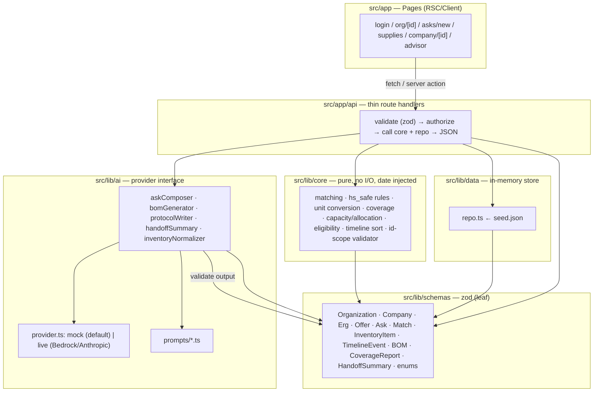

# Design Document

## Overview

Quippe is a single coordination front door between student-run STEM organizations and Massachusetts biotech companies. This document is the technical design for the MVP (features F1–F9 from `PROJECT_BRIEF.md`), satisfying Requirements 1–19 in `requirements.md`.

### Architectural philosophy: AI translates, deterministic code decides

The whole system is organized around one rule that appears in every steering doc and in the product principles: **the AI is a translator, not the decider.** Two kinds of work are kept strictly apart:

- **Translation (AI).** Turning an officer's free text into structured asks, a messy CSV into inventory rows, an experiment description into a bill of materials, and records into prose (handoff summary, adapted protocol). Every AI call produces JSON validated by a zod schema, retries exactly once with the validation error on failure, and returns a typed fallback the UI can render when validation ultimately fails (Req 8, 10, 12, 13, 19).
- **Decisions (deterministic pure functions).** Every matching, safety, eligibility, capacity, allocation, unit-conversion, and coverage decision is made by pure functions under `src/lib/core/` that take the current date as an argument and perform no I/O and no randomness (Req 11, 14, 15, 16, 18; tech.md conventions). No AI output is ever the sole determinant of a safety, eligibility, or matching decision (Req 19.7).

This split is what makes the product safe for minors and testable. The nine correctness properties in `PROJECT_BRIEF.md` section 9 all land on the deterministic side (plus the AI ID-scope guard, CP9), so they can be verified with property-based tests independent of any model.

### Non-goals (MVP scope)

Per `requirements.md` Introduction: no real authentication/sign-up, payments, chat, real email, mobile app, or tax receipts. Nice-to-haves (pooled pickup, Spanish toggle, calendar view, mocked email) are excluded. Data resets on restart; there is no database (tech.md).

## Architecture

The system is a Next.js (App Router) application with four `lib` layers and a strict, one-directional dependency rule enforced by convention and review (structure.md):

- **Pages (`src/app/.../page.tsx`)** render UI and never import from `lib/data` directly. They reach data only through API routes or server actions.
- **API routes (`src/app/api/...`)** are thin: validate input with zod, call `lib/core` and the repo, return JSON. They also perform role/authorization checks (Req 1, 4, 6, 9).
- **`lib/core`** holds pure business logic. It imports **only** from `lib/schemas`. It never imports from `lib/ai` or `lib/data`.
- **`lib/ai`** holds the provider interface, prompts, output schemas, and the mock provider. Every AI call routes through it (Req 19.1).
- **`lib/data`** holds the repository interface and the in-memory store loaded from `seed.json`.
- **`lib/schemas`** holds the zod schemas shared by API, AI, and seed. It is the leaf layer everything else can depend on.



Allowed dependency directions (arrows above). Forbidden, and checked in review:
- Pages → `lib/data` (must go through API/server actions).
- `lib/core` → `lib/ai` or `lib/core` → `lib/data` (core depends only on `lib/schemas`).

### Representative request flow: ask composer + supplies coverage

This is the demo "wow" path (F5 + F6), tracing Requirements 8, 10, 11, 12, 15, and 19.

```mermaid
sequenceDiagram
    participant U as Officer (page)
    participant API as API route
    participant AI as lib/ai
    participant CORE as lib/core (pure)
    participant REPO as lib/data repo

    Note over U,REPO: Ask composer (Req 8)
    U->>API: POST /api/asks/compose { text }
    API->>API: zod validate text length 1..5000 (Req 8.2)
    API->>AI: composeAsks(text)
    AI->>AI: validate output; retry once w/ error (Req 8.4, 19.4)
    AI-->>API: Ask[] | manualFallback (Req 8.6)
    API-->>U: drafts for review (nothing submitted) (Req 8.7)
    U->>API: POST /api/asks/confirm { ask } (explicit confirm)
    API->>CORE: gateHighSchoolInPerson(ask, org, now) (Req 9.1)
    API->>REPO: save ask (status open | pending_advisor_approval)

    Note over U,REPO: Supplies: experiment → BOM → coverage → protocol (Req 10–12)
    U->>API: POST /api/supplies/bom { experiment, groupSize }
    API->>AI: generateBom(...) validate+retry (Req 10.3,10.4) → BOM | fallback
    API->>REPO: read non-expired inventory across companies
    API->>CORE: buildCoverage(bom, inventory, org, now) (Req 11, 14.4, 15.8)
    CORE-->>API: CoverageReport (covered/partial/missing + company) (Req 11.2,11.3)
    API->>AI: writeProtocol(coverage) → validate IDs in-scope (CP9, Req 12.2)
    AI-->>API: Protocol | fallback (Req 12.4)
    API-->>U: coverage + adapted protocol (+ "Advisor must review" if HS) (Req 12.6)
```

The decisive steps (high-school gating, expiry/hs_safe filtering, coverage classification, ID-scope check) all happen in `lib/core` or in the AI wrapper's deterministic validator — never in the model output itself.

## Technology Stack and Dependencies

Chosen for a one-day build by a team strong in Python/R/SQL and lighter on frontend: boring, well-documented, simplest thing that works (tech.md).

| Concern | Choice | Notes |
|---|---|---|
| Framework | **Next.js 14+ (App Router)**, React 18 | Server components + thin API route handlers. |
| Language | **TypeScript, `strict: true`** | Strict mode required by tech.md. |
| Styling | **Tailwind CSS** | No component library unless it clearly saves time. |
| Validation | **zod** | Every API input, every AI output, and `seed.json` (tech.md, Req 19.3). |
| Data | **In-memory repository** loaded from `src/lib/data/seed.json` | No database; reset on restart is fine for the demo. |
| AI SDK (live) | Provider-specific SDK selected by env: **Amazon Bedrock** or **Anthropic** | Only loaded by the `live` provider; `mock` needs no network (Req 19.2). |
| Unit tests | **Vitest** | `npm test`. |
| Property tests | **fast-check** | One file per property group under `tests/properties/` (structure.md). |
| Deploy | **Vercel** (or AWS Amplify) | Must run with zero secrets using the mock provider (tech.md). |

Environment variables (documented in `.env.example`, never committed as `.env`): `AI_PROVIDER` (`mock` | `bedrock` | `anthropic`), `AI_MODEL`, and the provider key (`ANTHROPIC_API_KEY` or AWS credentials). When no key is set, the `mock` provider is used (Req 19.2).

Commands kept working (tech.md): `npm run dev`, `npm test`, `npm run lint`, `npm run seed:check`.

## Data Models

All domain types are defined as zod schemas in `src/lib/schemas/` and the TypeScript types are inferred with `z.infer`. The **same** schemas are imported by API routes (input validation), the AI layer (output validation), and the seed loader (`seed.json` validation via `npm run seed:check`). This single source of truth is what guarantees the seed, the AI, and the API agree on shape (tech.md, Req 19.3).

IDs are branded strings (e.g. `OrgId`, `CompanyId`) so the ID-scope validator (CP9) can compare sets without mixing namespaces.

### Enums

```ts
// src/lib/schemas/enums.ts
export const OrgType      = z.enum(["high_school_club", "college_club", "undergrad_lab", "community_org"]);
export const OfferType    = z.enum(["supplies", "lab_tour", "speaker", "erg_event"]);
export const AskStatus    = z.enum([
  "draft", "pending_advisor_approval", "open", "matched",
  "accepted", "declined", "completed", "rejected",   // "rejected" added for Req 9.5
]);
export const DeliveryMode = z.enum(["in_person", "virtual"]);
export const HazardClass  = z.enum([
  "none", "flammable", "corrosive", "toxic", "carcinogen", "biohazard", "oxidizer", "unknown",
]); // "unknown"/missing ⇒ hs_safe=false (Req 14.3)
export const Unit         = z.enum(["uL", "mL", "L", "mg", "g", "unit"]);
//            dimensions:  volume {uL,mL,L}   mass {mg,g}   count {unit}
export const CoverageStatus = z.enum(["covered", "partial", "missing"]);
```

### Core entities

```ts
// Organization (Req 2, 7, 9, 17)
Organization = {
  id: OrgId; type: OrgType; name: string; school: string; city: string;
  size: number;                 // int ≥ 1
  mission: string;              // org describes its own mission (Req 7.5, 17)
  underResourced: boolean;      // raises soft score (Req 16.1)
  ageYears: number;             // organization age used by min-age hard filter (Req 15.5)
  advisorAccountId?: AccountId; // required when type === "high_school_club" (refined)
};
// No student personal identity attributes are present anywhere in this model (Req 7.7, 17.4).

// Company (Req 4, 6, 13)
Company = { id: CompanyId; name: string; city: string; liaisonAccountId: AccountId; };

// Erg (Req 7)
Erg = {
  id: ErgId; companyId: CompanyId; leadAccountId: AccountId;
  name: string;            // 1..120
  description: string;     // 1..2000  (only text used for erg_event fit, Req 7.5)
  topics: string[];        // 1..20
  capacityPerSemester: number; // int 1..10000
};

// Offer (Req 4, 15)
Offer = {
  id: OfferId; companyId: CompanyId; ergId?: ErgId;  // ergId present iff type==="erg_event"
  type: OfferType;
  capacity: number;          // int 1..10000
  availableDates: string[];  // ISO dates; or cadence encoded as dates for the MVP
  deliveryMode: DeliveryMode;
  city: string;
  minAge?: number;           // int 0..25 when provided (Req 4.5)
  notes: string;             // ≤ 2000 chars (Req 4.5)
};

// Ask (Req 8, 9)
Ask = {
  id: AskId; orgId: OrgId;
  type: OfferType;
  groupSize: number;         // 1..500 (composer) / 1..500 (BOM path)
  preferredDates: string[];  // ISO dates
  deliveryMode: DeliveryMode;
  topic: string;
  needsSupplies: boolean;
  status: AskStatus;         // lifecycle per Req 6, 9
};

// Match (Req 5, 16)
Match = {
  askId: AskId; offerId: OfferId;
  score: number;             // soft score 0.0..1.0 (Req 16.1)
  reasons: string[];         // one per contributing factor (Req 16.4)
};

// InventoryItem (Req 11, 13, 14)
InventoryItem = {
  id: ItemId; companyId: CompanyId;
  name: string; category: string;
  quantity: number;          // available quantity > 0
  unit: Unit;
  expiry: string;            // ISO date; compared to run date (Req 11.7, 14.4, CP5)
  hazardClass: HazardClass;
  hsSafe: boolean;           // authoritative, computed by rules (Req 14) not AI
};

// TimelineEvent (Req 2, 6)
TimelineEvent = {
  id: EventId; orgId: OrgId; companyId?: CompanyId;
  kind: z.enum(["ask", "match", "visit", "donation", "accepted", "declined"]);
  date: string;              // ISO date; reverse-chron ordering (Req 2.4)
  seq: number;               // stable secondary sort key for same-date events (Req 2.4)
  summary: string;
  refs: string[];            // referenced entity IDs — the allowed-ID set for handoff (CP9)
};

// BOM (Req 10)
BomLine = {
  id: BomLineId; item: string; category: string;
  quantity: number;          // > 0
  unit: Unit; purpose: string; // all non-empty (Req 10.1)
};
BOM = { lines: BomLine[] };  // 1..200 lines

// Coverage (Req 11)
CoverageLine = {
  bomLineId: BomLineId; status: CoverageStatus;
  needed: number; allocated: number;
  supplyingCompanyId?: CompanyId; // present iff covered/partial; absent iff missing (Req 11.2)
  itemRefs: ItemId[];             // allocated inventory items — allowed-ID set for protocol (CP9)
};
CoverageReport = { lines: CoverageLine[]; runDate: string };

// HandoffSummary (Req 3)
HandoffSummary = {
  activeRelationships: string[]; contactsByRole: Record<string, string[]>;
  openAsks: string[]; whatWorked: string[];
  referencedIds: string[]; // must ⊆ input TimelineEvent refs (CP9, Req 3.3)
};
```

Account model is minimal (demo only): `Account = { id: AccountId; role: Role; orgId?; companyId?; ergId? }` where `Role = z.enum(["club_officer","club_advisor","club_member","company_liaison","erg_lead"])` — exactly one seeded account per role (Req 1.1). No credentials exist (Req 1.2).

## Components and Interfaces

### Repository interface — `src/lib/data/repo.ts`

The repo is the only module that touches the in-memory store. It is loaded from `seed.json` at startup (validated by the schemas). Methods are synchronous for the MVP (in-memory) but typed as `Promise` so a future DB swap needs no call-site changes. The repo **applies the expired-item filter on every inventory read** so no layer can accidentally surface expired items (Req 14.4); callers still pass the run date so the core filter stays pure.

```ts
interface Repo {
  // Accounts / auth (Req 1)
  listDemoAccounts(): Promise<Account[]>;
  getAccount(id: AccountId): Promise<Account | null>;

  // Organizations & timeline (Req 2, 6)
  getOrganization(id: OrgId): Promise<Organization | null>;        // null ⇒ not found (Req 2.6)
  listTimelineEvents(orgId: OrgId): Promise<TimelineEvent[]>;
  addTimelineEvent(e: TimelineEvent): Promise<void>;

  // Companies, offers, ERGs (Req 4, 7)
  getCompany(id: CompanyId): Promise<Company | null>;
  listOffers(filter?: { companyId?: CompanyId }): Promise<Offer[]>;
  createOffer(o: Offer): Promise<Offer>;
  updateOffer(o: Offer): Promise<Offer>;      // caller checks ownership first (Req 4.4)
  getErg(id: ErgId): Promise<Erg | null>;
  createErg(e: Erg): Promise<Erg>;
  ergExistsForCompany(companyId: CompanyId): Promise<boolean>;     // Req 7.4

  // Asks (Req 5, 6, 8, 9)
  getAsk(id: AskId): Promise<Ask | null>;
  listAsks(filter?: { orgId?: OrgId; status?: AskStatus }): Promise<Ask[]>;
  saveAsk(a: Ask): Promise<Ask>;
  setAskStatus(id: AskId, status: AskStatus): Promise<Ask>;

  // Inventory (Req 11, 13, 14)
  listInventory(runDate: string, filter?: { companyId?: CompanyId }): Promise<InventoryItem[]>; // never returns expired (Req 14.4)
  saveInventory(items: InventoryItem[]): Promise<InventoryItem[]>;  // confirmed items only (Req 13.5)

  // Seed table (Req 15.6)
  getCityCoords(city: string): Promise<{ lat: number; lon: number } | null>;
}
```

### AI provider interface — `src/lib/ai/provider.ts`

```ts
interface AiProvider {
  // Returns raw text (JSON for structuring tasks, prose for writing tasks).
  complete(input: { prompt: string; maxTokens?: number }): Promise<string>;
}
// mockProvider: matches the prompt to a canned, schema-valid response (default when no key, Req 19.2).
// liveProvider: dispatches to Bedrock or Anthropic by AI_PROVIDER/AI_MODEL/key.
function getProvider(): AiProvider; // returns mock unless a live key is configured
```

Every prompt lives in `src/lib/ai/prompts/*.ts` as an exported template function, and every prompt has a matching canned response in the mock provider (ai-rules.md).

### Core module APIs — `src/lib/core/*` (pure, date injected, no I/O, no randomness — Req 15.1)

```ts
// matching.ts (Req 15, 16)
function applyHardFilters(
  offers: Offer[], ask: Ask, org: Organization, inventory: InventoryItem[],
  coords: CityCoordsTable, now: string
): Offer[];                                   // Req 15.2–15.10, uses CP1/CP5 filters
function rankMatches(
  candidates: { offer: Offer; org: Organization; pastMatchCount: number; askText: string }[],
  ask: Ask, now: string
): Match[];                                   // Req 16; deterministic (CP6), score∈[0,1], one reason/factor
function topicFit(askText: string, offerText: string): number; // 0..1 (Req 16.2)

// erg.ts (Req 7.5) — fit from org mission + ask text vs erg description only
function ergFit(orgMission: string, askText: string, ergDescription: string): number; // 0..1

// units.ts (Req 11.5, CP7)
function convert(qty: number, from: Unit, to: Unit): number | null; // null when dimensions differ (Req 11.6)

// coverage.ts (Req 11, 14.4, 15.8)
function buildCoverage(
  bom: BOM, inventory: InventoryItem[], org: Organization, now: string
): CoverageReport; // filters expired (CP5) + hs_safe for HS (CP1); allocates; classifies (CP8)

// safety.ts (Req 14)
function computeHsSafe(item: { hazardClass: HazardClass; name: string; category: string; notes?: string },
                       aiSuggestedHsSafe: boolean, keywords: string[]): boolean; // Req 14.1–14.3
function visibleToCompany(ask: Ask): boolean; // false for pending_advisor_approval & rejected (CP2)
function gateHighSchoolInPerson(ask: Ask, org: Organization): AskStatus; // Req 9.1

// capacity.ts (Req 6, 18)
function canAccept(offer: Offer, acceptedGroupSizesInPeriod: number[], newGroupSize: number): boolean; // CP3
function allocate(available: number, demands: number[]): number[]; // Σ ≤ available (CP4)

// eligibility.ts
function rejectsStudentIdentity(payload: unknown): boolean; // Req 7.6, 17.5 (keyword/field guard)

// timeline.ts (Req 2.4)
function sortTimeline(events: TimelineEvent[]): TimelineEvent[]; // date desc, then seq asc (stable)

// refs.ts (CP9)
function validateReferencedIds(referenced: string[], allowed: Set<string>): boolean; // Req 3.3, 12.2, 19.6
```

### AI module APIs — `src/lib/ai/*` (each: input → zod output schema → one retry with error → typed fallback)

| Function | Input | Output schema | Retry | Typed fallback | Requirements |
|---|---|---|---|---|---|
| `composeAsks` | free text 1..5000 | `z.array(Ask).min(1).max(20)` | once, with validation error (Req 8.4) | `{ kind: "manual_form"; extracted: Partial<Ask>[] }` pre-filled (Req 8.6) | 8, 19 |
| `generateBom` | experiment 1..2000, groupSize 1..500 | `BOM` (1..200 lines, each field non-empty, qty>0) | once (Req 10.4) | `{ kind: "bom_failed" }` (Req 10.5) | 10, 19 |
| `writeProtocol` | `CoverageReport` | `Protocol` schema; **IDs must be ⊆ coverage item IDs** (CP9) and must list every missing BOM line (Req 12.3) | once | `{ kind: "protocol_rejected"; reason }` (Req 12.4) | 12, 19 |
| `handoffSummary` | `TimelineEvent[]` | `HandoffSummary`; **referencedIds ⊆ input refs** (CP9) | once | `{ kind: "handoff_fallback" }` (Req 3.4, 3.5) | 3, 19 |
| `normalizeInventory` | CSV rows (≤10MB, ≤5000 rows) | `z.array(InventoryItem)` (hsSafe later overwritten by rules) | once (Req 13.6) | `{ kind: "manual_table"; rows }` (Req 13.7) | 13, 19 |

The AI wrapper (`src/lib/ai/run.ts`) is the single enforcement point for Req 19: it calls `getProvider().complete`, validates with the given zod schema, on failure retries exactly once with the error appended to the prompt, runs `validateReferencedIds` when an allowed-ID set is supplied (CP9), and returns the typed fallback if validation still fails. No AI output ever drives a safety/eligibility/matching decision on its own (Req 19.7) — e.g. `hsSafe` from `normalizeInventory` is always overwritten by `computeHsSafe`.

### API route surface — `src/app/api/...` (thin: validate → authorize → core + repo → JSON)

| Route | Responsibility | Requirements |
|---|---|---|
| `POST /api/session` | Select a seeded demo account, bind role session, return landing view | 1.1,1.3,1.6 |
| `GET /api/org/[id]` | Org profile + sorted timeline; 404 when missing; read-only for members | 2.1–2.6 |
| `POST /api/org/[id]/handoff` | Generate handoff summary from this org's timeline only; fallback on bad/empty refs | 3 |
| `POST /api/offers`, `PUT /api/offers/[id]` | Create/edit offer; zod-validate; ownership check on edit | 4 |
| `GET /api/company/[id]/dashboard` | Matched asks sorted by score desc (stable tie-break); excludes pending HS asks | 5 |
| `POST /api/asks/[id]/accept`, `/decline` | Status transition from `matched`; capacity check; dual timeline events | 6, 18 |
| `POST /api/ergs`, `POST /api/offers` (erg_event) | Create ERG (bounds); require ERG before `erg_event`; reject student identity | 7 |
| `POST /api/asks/compose`, `POST /api/asks/confirm` | AI structuring + explicit per-ask confirm; HS in-person gating on confirm | 8, 9.1 |
| `GET /api/advisor/queue`, `POST /api/asks/[id]/approve`/`reject` | Advisor-scoped approval queue and transitions | 9 |
| `POST /api/supplies/bom`, `POST /api/supplies/coverage`, `POST /api/supplies/protocol` | BOM → deterministic coverage → adapted protocol | 10, 11, 12 |
| `POST /api/inventory/normalize`, `POST /api/inventory/confirm` | CSV normalize to review table; persist only on confirm; rules set `hsSafe` | 13, 14 |

Role authorization is a shared guard applied in each route (Req 1.4, 1.5, 4.4, 6.3, 9.4); denied requests return a role-appropriate message and change no data.

## Correctness Properties

*A property is a characteristic or behavior that should hold true across all valid executions of a system — essentially, a formal statement about what the system should do. Properties serve as the bridge between human-readable specifications and machine-verifiable correctness guarantees.*

This feature is dominated by pure deterministic logic (matching, unit conversion, coverage, capacity, allocation, safety filters) and a deterministic AI-output guard — all ideal for property-based testing. Role gating, CRUD, CSV upload, and UI rendering are **not** suitable for PBT and are covered by example-based unit tests and mock-provider integration tests instead.

The nine properties below come directly from `PROJECT_BRIEF.md` section 9 and the requirement clauses that cite them. Each is implemented by a **single** fast-check property test (minimum 100 iterations) under `tests/properties/`, tagged `Feature: open-bench-mvp, Property {n}: {text}`, with the property number in the file/test name. After the prework analysis, redundant candidates were consolidated — e.g. the "allocated ≤ available" invariant (CP4) and the "fully covered iff allocated ≥ needed" biconditional (CP8) are kept distinct because they validate different guarantees of the same `buildCoverage`/`allocate` code.

### Property 1: hs_safe items never reach a high school club

*For all* inventory snapshots and *for all* asks from a `high_school_club` organization, no `InventoryItem` with `hsSafe === false` appears in the hard-filtered match set, the coverage report item references, or the protocol inputs. For a non-high-school org, hs_safe filtering does not remove otherwise-eligible items.

Exercises: `applyHardFilters`, `buildCoverage`. Test: `tests/properties/prop01-hs-safe-exclusion.property.test.ts`.

**Validates: Requirements 12.5, 15.9**

### Property 2: pending approval asks are hidden from companies

*For all* asks, if an ask's status is `pending_advisor_approval` (or `rejected`), then `visibleToCompany` returns false and the ask is absent from every company-facing query result; asks in company-visible statuses are retained.

Exercises: `visibleToCompany`, company dashboard/advisor filters. Test: `tests/properties/prop02-pending-hidden.property.test.ts`.

**Validates: Requirements 5.6, 9.2**

### Property 3: accepted group size never exceeds offer capacity

*For all* offer capacities and *for all* sequences of accept attempts, folding `canAccept` over the sequence yields an accepted total that is always ≤ capacity at every step, and an accept is refused exactly when it would overflow.

Exercises: `canAccept`. Test: `tests/properties/prop03-capacity-invariant.property.test.ts`.

**Validates: Requirements 6.7, 18.1**

### Property 4: allocated inventory quantity never exceeds available

*For all* available quantities and *for all* demand sequences, `allocate` returns allocations whose sum is ≤ the available quantity.

Exercises: `allocate` (within `buildCoverage`). Test: `tests/properties/prop04-allocation-invariant.property.test.ts`.

**Validates: Requirements 18.2**

### Property 5: expired items never appear

*For all* inventory snapshots and *for all* run dates, items whose expiry is earlier than or equal to the run date are excluded from matches and coverage; items with a later expiry are retained.

Exercises: expiry filter used by `applyHardFilters` and `buildCoverage`. Test: `tests/properties/prop05-expiry-exclusion.property.test.ts`.

**Validates: Requirements 11.7, 14.4, 15.8**

### Property 6: matching is deterministic

*For all* sets of offers, asks, organizations, city coordinates, and run dates, two invocations of `rankMatches` with identical inputs produce identical ranked output — the same set of matches in the same order.

Exercises: `rankMatches` (and tie-break fairness, Req 16.3). Test: `tests/properties/prop06-matching-determinism.property.test.ts`.

**Validates: Requirements 16.6**

### Property 7: unit conversions round-trip within tolerance

*For all* positive quantities and *for all* unit pairs within the same dimension (µL/mL/L, mg/g), converting to the other unit and back returns the original quantity within a relative tolerance of 0.0001; cross-dimension conversions return the non-convertible signal.

Exercises: `convert`. Test: `tests/properties/prop07-unit-roundtrip.property.test.ts`.

**Validates: Requirements 11.5**

### Property 8: coverage "fully covered" iff allocated ≥ needed

*For all* BOMs and *for all* inventory snapshots, every coverage line is marked `covered` if and only if its allocated quantity ≥ its needed quantity; `partial` iff `0 < allocated < needed`; `missing` iff `allocated === 0`.

Exercises: `buildCoverage` classification. Test: `tests/properties/prop08-coverage-biconditional.property.test.ts`.

**Validates: Requirements 11.3, 11.4**

### Property 9: AI outputs reference only input IDs

*For all* allowed-ID sets and *for all* AI outputs, `validateReferencedIds` accepts the output if and only if every referenced ID is in the allowed set; when any unknown ID is present, the AI wrapper rejects the output and returns the typed fallback. Applies to handoff summaries, adapted protocols, and the generic AI wrapper.

Exercises: `validateReferencedIds`, AI wrapper reject-and-fallback. Test: `tests/properties/prop09-id-scope.property.test.ts`.

**Validates: Requirements 3.3, 12.2, 19.6**

## Testing Strategy

The testing approach is dual: fast-check property tests verify the universal properties above across many generated inputs, and Vitest unit tests cover concrete examples, boundaries, and error conditions. All AI behavior is tested against the mock provider so tests need no network and no secrets. Each of the nine named properties maps to exactly one property test file (minimum 100 iterations), tagged `Feature: open-bench-mvp, Property {n}: {text}` with the property number in the name, under `tests/properties/` (structure.md).

### Supporting property tests (beyond the named nine)

These also use fast-check because behavior varies meaningfully with input:
- Hard-filter soundness: type mismatch, capacity < group size, no date overlap, under-min-age, over-distance, or missing coordinates always exclude the pair (Req 15.2–15.7).
- Soft score bounds: `rankMatches` score ∈ [0,1] and exactly one reason per contributing factor for all inputs (Req 16.1, 16.4).
- `computeHsSafe` collapses to false whenever the AI suggestion and the rule disagree, or hazard class is missing/unrecognized (Req 14.2, 14.3).
- Timeline ordering: `sortTimeline` is a stable reverse-chron order identical on repeated calls (Req 2.4).

### Unit tests (`tests/unit/`)

Example-based tests for concrete behavior and edges that PBT does not cover well:
- zod schema acceptance/rejection at boundaries: offer capacity 1 and 10000, minAge 0 and 25, notes length 2000; ERG bounds; ask length limits (Req 4.5, 4.6, 7.1, 7.2, 8.2, 10.2).
- Status-transition guards: accept/decline only from `matched` (Req 6.3); advisor approve/reject only from `pending_advisor_approval` by the matching org (Req 9.3–9.5).
- Role authorization: each role sees only permitted views/actions; denied actions change no data (Req 1.4, 1.5).
- Not-found org returns a not-found indication (Req 2.6); empty-timeline indicator (Req 2.5); empty matched-asks state (Req 5.5).

### Mock-provider testing approach

All tests run against the `mock` AI provider (no network, Req 19.2). Each prompt's canned response is schema-valid by default (ai-rules.md). To test retry-then-fallback deterministically, tests swap in a stub provider that returns:
- a schema-invalid payload on the first call and a valid one on the second (verifies the single retry includes the validation error — Req 8.4, 10.4, 13.6, 19.4),
- an invalid payload on both calls (verifies the typed fallback — Req 8.6, 10.5, 12.4, 13.7, 19.5),
- a payload referencing an unknown ID (verifies rejection + fallback — CP9 / Req 19.6).

## Error Handling

- **zod input validation failures.** API routes validate every input and return the per-field errors with the submission rejected and stored data unchanged (Req 4.6, 7.2, 8.2, 10.2, 13.2). The entered values are retained for re-editing where the requirement calls for it (Req 8.2, 10.2).
- **AI retry-then-fallback.** The AI wrapper validates output, retries once with the validation error appended, and returns the typed fallback on a second failure or on timeout (Ask composer must resolve within 30 s — Req 8.5, 8.6). Each fallback is a typed union the UI renders explicitly: manual ask form, manual inventory table, BOM-failed notice, protocol-rejected notice, handoff fallback (Req 3.4, 10.5, 12.4, 13.7, 19.5).
- **Unknown-ID references (CP9).** Any AI output referencing an ID outside its input set is discarded; the route returns an unknown-identifier error and the typed fallback (Req 3.4, 12.4, 19.6).
- **Capacity / allocation rejection.** Accepting an ask that would exceed offer capacity is refused with no status change and no timeline event, surfacing a capacity-exceeded error (Req 6.7, 18.3). An allocation exceeding available quantity is refused with existing allocations unchanged (Req 18.4).
- **Authorization errors.** Editing an offer not owned by the liaison's company, approving/rejecting an ask for a non-matching org, or any out-of-role action is rejected with a role-appropriate message and no data change (Req 4.4, 9.4, 1.5). Contact attempts aimed at a high school student member are rejected and routed to the advisor/org account, with no student-addressed record retained (Req 17.1–17.3).
- **Not-found cases.** Requests referencing a non-existent organization (or offer/ask) return a not-found indication rather than rendering a page (Req 2.6).
- **Bad status transitions.** Accept/decline outside `matched`, or approve/reject outside `pending_advisor_approval`, are rejected and leave status unchanged (Req 6.3, 9.3–9.5).

## Security and Privacy Considerations

- **No student identity data.** The data model stores no student personal identity attribute (full name, DOB, home address, personal email/phone, photo, government ID). Any create/update payload containing such an attribute is rejected by `rejectsStudentIdentity` and nothing is persisted (Req 7.6, 7.7, 7.8, 17.4, 17.5). Matching and ERG fit use only org mission and ask text vs ERG description (Req 7.5).
- **High-school contact routing.** There is no UI control or endpoint for a liaison or ERG lead to contact a high school student member; all contact routes to the advisor or the organization account as the sole recipient (Req 17.1–17.3).
- **Pending-approval hiding.** In-person high school asks sit in `pending_advisor_approval` and are excluded from every company-facing view and query until an advisor approves (Req 5.6, 9.1, 9.2 / CP2). Rejected asks stay hidden (Req 9.5).
- **AI never decides safety/eligibility/matching.** Deterministic rules own every such decision; AI `hsSafe` suggestions are always overridden by `computeHsSafe`, and conservative defaults apply on disagreement or unknown hazard class (Req 14, 19.7).
- **Fictional data only.** Seed companies, people, and schools are fictional; no real company names or logos appear anywhere (Req 17.6, 17.7; tech.md "Never").
- **No secrets in code.** No `.env` is committed; `.env.example` documents `AI_PROVIDER`, `AI_MODEL`, and the provider key. The app runs with zero secrets using the mock provider (tech.md, Req 19.2).
- **Accessibility (WCAG AA), cross-cutting.** All user-facing views meet AA contrast, use labeled form fields, support full keyboard navigation, and explain acronyms on first use (requirements.md Introduction; product.md principles 5–6). Validation errors are associated with their fields for screen readers. Full AA conformance requires manual testing with assistive technology and expert review beyond automated checks.

## Design Decisions and Rationale

| Decision | Rationale | Trade-offs | Ties to |
|---|---|---|---|
| **In-memory repository from `seed.json`, no database** | One-day build; a team strong in SQL but short on time ships faster with zero DB setup; reset-on-restart is acceptable for a demo. The `Repo` interface and `Promise` signatures leave a clean seam to add a DB later. | No persistence across restarts; concurrency is single-process. Acceptable for the demo. | tech.md; Req 1, 2, 13 |
| **AI as translator, deterministic core decides** | Safety for minors and trust in rankings require decisions that are inspectable and testable; models are neither. Keeps all nine correctness properties on code we can prove. | Some logic the model could "just do" is written by hand (keyword overlap, unit conversion). Worth it for safety and determinism. | brief §8; product principle 2; Req 15.1, 19.7 |
| **Pure core with injected current date** | Pure functions with no I/O, no randomness, and an injected date are deterministic and directly property-testable; the expiry/matching/coverage properties depend on it (CP5, CP6). | Callers must thread `now` everywhere. Minor ergonomic cost, large testability gain. | tech.md; Req 11, 14, 15, 16; CP5, CP6 |
| **Mock-first AI provider (default when no key)** | Offline demo backup and deterministic tests; satisfies "runs with zero secrets". A single provider interface lets the team switch to Bedrock/Anthropic by env var without touching call sites. | Mock responses must be maintained alongside each prompt. ai-rules.md already requires this. | tech.md; Req 19.1, 19.2 |
| **Shared zod schemas (API + AI + seed)** | One source of truth prevents drift between what the seed contains, what the AI must emit, and what the API accepts; `npm run seed:check` validates the seed against the same schemas. | Schemas must be written carefully up front; changes ripple to three consumers (intended). | tech.md; structure.md; Req 19.3 |
| **Deterministic `hs_safe` overrides AI, conservative on disagreement/unknown** | Unsafe items must never reach high school clubs; defaulting to `false` on any doubt is the safe failure mode. | May mark a borderline-safe item unsafe. Correct bias for minors. | brief §F7; Req 14.1–14.3; CP1 |
| **Added `rejected` to the Ask status enum** | Req 9.5 requires a rejected-by-advisor terminal state distinct from `declined` (which is a company outcome). | One more status to handle in UI/filters. | Req 9.5; CP2 |
| **Expiry filtered at the repo read boundary** | Guarantees no layer can surface expired items even if a caller forgets; the core filter stays pure by taking `now`. | Slight duplication of the expiry check (repo + core). Defense in depth is worth it. | Req 14.4; CP5 |
| **Tailwind, no component library** | Fastest path for a frontend-light team; avoids learning a library under time pressure while still meeting AA with labeled fields and semantic HTML. | More hand-written markup. Acceptable at MVP size. | tech.md; product principles 5–6 |
